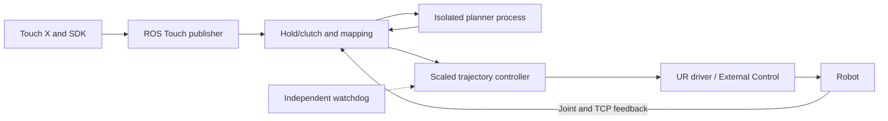

# Architecture

## Shared Touch input

`drivers/touch_x/touch_probe.cpp` reads position, transform, calibration and button state through OpenHaptics. `pace_serial.c` applies the Linux USB write-spacing workaround. `scripts/run_touch_x.sh` verifies the tested SDK/driver binaries and keeps runtime device configuration local.

`scripts/touch_x_publisher.py` converts millimetres to metres and publishes approximately 100 Hz on `/touch_x/pose`, `/touch_x/state` and `/touch_x/valid`. Samples retain their original timing. Physical operation prohibits Touch force output.

## Physical path (domain 43)

A hold of 0.25 s captures Touch and robot-position anchors. The target is:

`robot_anchor + scale * M * (touch_position - touch_anchor)`

`M` maps Touch `(X,Y,Z)` to robot-base `(X,-Z,Y)`. The current physical mode is relative XYZ position control with fixed orientation. Releasing requests cancellation; a fresh hold captures new anchors. Triple taps report RCM unavailable, because measured pivot/tool-tip geometry is not configured.

The parent process handles feedback, button release, action results and a watchdog heartbeat. A single spawned worker performs calibrated inverse kinematics and conservative geometry checking. Only one plan is outstanding. The worker has no ROS command clients or device handles. Results are rejected if the engagement changed, the original snapshot aged past 100 ms, or robot/hand state moved outside the acceptance bounds. Fresh incoming feedback cannot renew an old planning snapshot. Three consecutive expired plans or a stalled worker end the session.

Each endpoint advances at most 1.5 mm; the nominal 300 ms trajectory ends at zero velocity/acceleration. The controller blends from its latest commanded state. The project-local plugin corrects the installed UR 2.16 controller's initial clock type, avoiding a ROS_TIME/SYSTEM_TIME exception during activation. It retains the upstream controller algorithm and speed scaling.

The independent guard has a 250 ms heartbeat lease and requests controller deactivation on child failure. Finite trajectories, software workspace/geometry checks, fresh feedback and pendant controls serve different roles; none makes this a certified safety system.

## Simulation path (domain 42)

MuJoCo provides simulated joints and contact data. `touch_x_sim_teleop.py` and the command router apply mapping and command leases. `ros2/sim_contact_feedback` publishes simulated contact forces. When explicitly enabled, those forces are mapped back to Touch coordinates and passed through native magnitude, slew-rate, freshness, button and energy limits. MuJoCo is not part of physical robot control.
